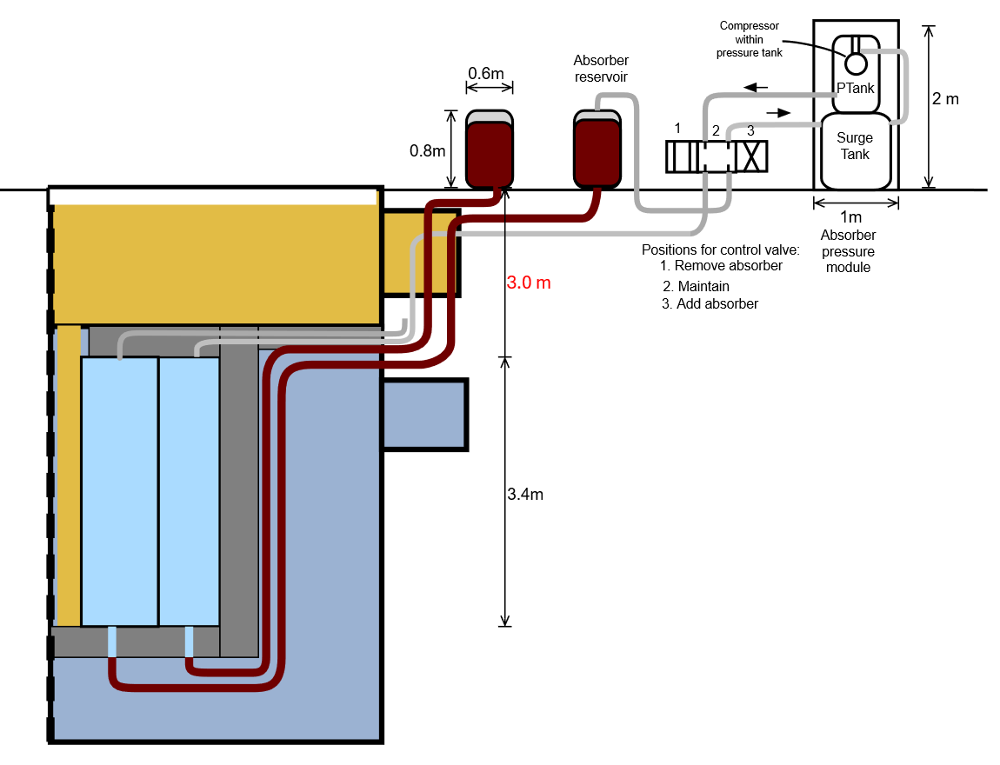

---------------
decimalFormat: 1,000,000.
fontSize: 12
pageSize: letter
dateFormat: undefined
saveDate: 2026-10-15
---------------

# Absorber capacity and gas module screen

Preliminary review, 15 October 2026. Twelve circuits: primary A and secondary B
at each of six radial assemblies. Source chamber volumes are 0.1589 and 0.1938
m³; their neutronic sufficiency is not reassessed. Current 3D elevations
override the older sketch. The absorber bottom is raised 0.30 m to the
active-core bottom; other equipment envelopes are retained.

All editable equations below use **SI scalar values**: metres, cubic metres,
pascals absolute, kg/m³ and m/s². Outputs ending L are litres; kPa outputs are
absolute. These balance pressures are not adopted settings.

## Geometry and assumptions

The original measured absorber tank was 2.10 × 0.08 × 3.95 m, Z = -7.57 to -3.62

 m.  The owner excludes the bottom reflector: the adopted bottom is Z = -7.27 m and
    the remaining envelope is 3.65 m tall. The active core spans Z = -7.27 to
    -3.87 m, 3.4 m high. Reservoir bottoms are Z = -0.05 m. No salt volume
    below the active core is included. The second case estimates the 0.25 m
    upper region as retained gas space, using the source chamber
    cross-sections; it is not additional salt fill. Partition geometry remains
    unresolved.

Density is inferred from document Eq 1, not independently specified. Reservoirs
are provisionally treated as gross cylinders, with salt charge equal to chamber
volume, zero heel, unchanged prefilled line inventory, and the remaining gas
space initially at 100 kPa absolute. Pressure-vessel volume equals chamber
volume as in the source. Gas is isothermal at equal temperature; real hot/cold
gas differences and line volumes need review.

¢` Gravity = 9.81 `

¢` SourcePressure = 337790 `

¢` SurgeInitial = 100000 `

¢` SourceHead = 7.2 `

¢` PrimaryCharge = 0.1589 `

¢` SecondaryCharge = 0.1938 `

¢` ActiveHeight = 3.4 `

¢` AbsorberTankLength = 2.1 `

¢` AbsorberTankWidth = 0.08 `

¢` AbsorberTankHeight = 3.65 `

¢` WallTrial = 0.003 `

¢` TankDiameter = 0.806349471933 `

¢` TankHeight = 1.25992104989 `

¢` ReservoirBottom = -0.05 `

¢` CoreBottom = -7.27 `

¢` CoreTop = -3.87 `

¢` AbsorberTankBottom = -7.27 `

¢` AbsorberTankTop = -3.62 `

¢` UpperGasHeight = 0.25 `

¢??` Density = (SourcePressure - SurgeInitial) / (Gravity SourceHead) =
〔3,366.60437195605〕 `

¢??` Gradient = Density Gravity = 〔33,026.3888888889〕 `

¢??` TankArea = π TankDiameter^2 / 4 = 〔0.51066547027635〕 `

¢??` TankVolume = TankArea TankHeight = 〔0.64339817545315〕 `

¢??` TankLitres = 1000 TankVolume = 〔643.39817545315〕 `

¢??` AbsorberTankGrossL = 1000 AbsorberTankLength AbsorberTankWidth
AbsorberTankHeight = 〔613.2〕 `

¢??` AbsorberTankActiveL = 1000 AbsorberTankLength AbsorberTankWidth
ActiveHeight = 〔571.2〕 `

¢??` TrialNetL = 1000 (AbsorberTankLength - 3 WallTrial) (AbsorberTankWidth - 2
WallTrial) ActiveHeight = 〔526.0956〕 `

¢??` ChargeTotalL = 1000 (PrimaryCharge + SecondaryCharge) = 〔352.7〕 `

¢??` ReservoirTrialL = 0.8 TankLitres = 〔514.71854036252〕 `

The 3 mm wall/partition trial and 80% reservoir allowance are capacity
sensitivities only. No metal thickness, usable fill fraction or chamber
division is adopted. The physical fit must also accommodate the separate
bottom-fed external salt tubes.

## Corrected source balance

Eq 5 must include the hydrostatic term in its denominator. For the original 3 m
gap and a zero-headspace full reservoir:

¢??` SourcePrimarySurgeL = 1000 SourcePressure PrimaryCharge / (SourcePressure /
2 + Gradient * 3 - SurgeInitial) = 〔319.542177616598〕 `

¢??` SourceSecondarySurgeL = 1000 SourcePressure SecondaryCharge /
(SourcePressure / 2 + Gradient * 3 - SurgeInitial) = 〔389.724820780973〕 `

The result reproduces about 319.6 and 389.7 litres. The source intermediate Eq
14 also has a sign inconsistency; its Eq 17 correctly gives head = hp + initial
salt depth - filled height - reservoir level drop. Continuity means equal
volume flow, not equal velocities in unequal areas.

## Current reservoir and elevation screen

For each circuit, p0 is the static pressure needed to hold its chamber empty. On
switching, the pressure vessel mixes with the reservoir headspace. Final
reservoir pressure is (p0 Vp + ps0 Vg0)/(Vp + Vg0 + charge). With retained
chamber gas volume Va, the required surge volume is \[p0 charge + (p0 - final
gas pressure) Va] / (final gas pressure - initial surge pressure). This follows
from final hydrostatic balance and conservation of gas. Equilibrium at exactly
full is a mathematical screen, not a carryover-prevention design. D-071 adds
separate charging and discharge services: both module service isolation valves
are closed for this normal-duty gas balance. Shared headers are excluded;
additional module-side dead-leg volume remains to include.

### Active Band primary

¢??` ActivePrimaryVolume = PrimaryCharge = 〔0.1589〕 `

¢??` ActivePrimaryGasVolume = 0 = 〔0〕 `

¢??` ActivePrimaryDepth = ActivePrimaryVolume / TankArea = 〔0.311162608887595〕 `

¢??` ActivePrimaryHp = ReservoirBottom - CoreBottom = 〔7.22〕 `

¢??` ActivePrimaryHf = ReservoirBottom - CoreTop = 〔3.82〕 `

¢??` ActivePrimaryP0 = SurgeInitial + Gradient (ActivePrimaryHp +
ActivePrimaryDepth) = 〔348,727.105106581〕 `

¢??` ActivePrimaryFinal = (ActivePrimaryP0 ActivePrimaryVolume + SurgeInitial
(TankVolume - ActivePrimaryVolume)) / (ActivePrimaryVolume + TankVolume) =
〔129,456.301565297〕 `

¢??` ActivePrimarySurge = (ActivePrimaryP0 ActivePrimaryVolume +
(ActivePrimaryP0 - ActivePrimaryFinal - Gradient ActivePrimaryHf)
ActivePrimaryGasVolume) / (ActivePrimaryFinal + Gradient ActivePrimaryHf -
SurgeInitial) = 〔0.356083839538297〕 `

¢??` ActivePrimaryPressureL = 1000 ActivePrimaryVolume = 〔158.9〕 `

¢??` ActivePrimarySurgeL = 1000 ActivePrimarySurge = 〔356.083839538297〕 `

¢??` ActivePrimaryTotalL = 1000 (ActivePrimaryVolume + ActivePrimarySurge) =
〔514.983839538297〕 `

¢??` ActivePrimaryP0kPa = ActivePrimaryP0 / 1000 = 〔348.727105106581〕 `

### Active Band secondary

¢??` ActiveSecondaryVolume = SecondaryCharge = 〔0.1938〕 `

¢??` ActiveSecondaryGasVolume = 0 = 〔0〕 `

¢??` ActiveSecondaryDepth = ActiveSecondaryVolume / TankArea =
〔0.379504805553279〕 `

¢??` ActiveSecondaryHp = ReservoirBottom - CoreBottom = 〔7.22〕 `

¢??` ActiveSecondaryHf = ReservoirBottom - CoreTop = 〔3.82〕 `

¢??` ActiveSecondaryP0 = SurgeInitial + Gradient (ActiveSecondaryHp +
ActiveSecondaryDepth) = 〔350,984.201071182〕 `

¢??` ActiveSecondaryFinal = (ActiveSecondaryP0 ActiveSecondaryVolume +
SurgeInitial (TankVolume - ActiveSecondaryVolume)) / (ActiveSecondaryVolume +
TankVolume) = 〔134,950.790655698〕 `

¢??` ActiveSecondarySurge = (ActiveSecondaryP0 ActiveSecondaryVolume +
(ActiveSecondaryP0 - ActiveSecondaryFinal - Gradient ActiveSecondaryHf)
ActiveSecondaryGasVolume) / (ActiveSecondaryFinal + Gradient
ActiveSecondaryHf - SurgeInitial) = 〔0.42219641395896〕 `

¢??` ActiveSecondaryPressureL = 1000 ActiveSecondaryVolume = 〔193.8〕 `

¢??` ActiveSecondarySurgeL = 1000 ActiveSecondarySurge = 〔422.19641395896〕 `

¢??` ActiveSecondaryTotalL = 1000 (ActiveSecondaryVolume + ActiveSecondarySurge)
= 〔615.99641395896〕 `

¢??` ActiveSecondaryP0kPa = ActiveSecondaryP0 / 1000 = 〔350.984201071182〕 `

### Upper Gas Space primary

¢??` UpperPrimaryVolume = PrimaryCharge = 〔0.1589〕 `

¢??` UpperPrimaryGasVolume = UpperPrimaryVolume / ActiveHeight * UpperGasHeight
= 〔0.0116838235294118〕 `

¢??` UpperPrimaryDepth = UpperPrimaryVolume / TankArea = 〔0.311162608887595〕 `

¢??` UpperPrimaryHp = ReservoirBottom - CoreBottom = 〔7.22〕 `

¢??` UpperPrimaryHf = ReservoirBottom - CoreTop = 〔3.82〕 `

¢??` UpperPrimaryP0 = SurgeInitial + Gradient (UpperPrimaryHp +
UpperPrimaryDepth) = 〔348,727.105106581〕 `

¢??` UpperPrimaryFinal = (UpperPrimaryP0 UpperPrimaryVolume + SurgeInitial
(TankVolume - UpperPrimaryVolume)) / (UpperPrimaryVolume + TankVolume) =
〔129,456.301565297〕 `

¢??` UpperPrimarySurge = (UpperPrimaryP0 UpperPrimaryVolume + (UpperPrimaryP0 -
UpperPrimaryFinal - Gradient UpperPrimaryHf) UpperPrimaryGasVolume) /
(UpperPrimaryFinal + Gradient UpperPrimaryHf - SurgeInitial) =
〔0.363074592710725〕 `

¢??` UpperPrimaryPressureL = 1000 UpperPrimaryVolume = 〔158.9〕 `

¢??` UpperPrimarySurgeL = 1000 UpperPrimarySurge = 〔363.074592710725〕 `

¢??` UpperPrimaryTotalL = 1000 (UpperPrimaryVolume + UpperPrimarySurge) =
〔521.974592710725〕 `

¢??` UpperPrimaryP0kPa = UpperPrimaryP0 / 1000 = 〔348.727105106581〕 `

### Upper Gas Space secondary

¢??` UpperSecondaryVolume = SecondaryCharge = 〔0.1938〕 `

¢??` UpperSecondaryGasVolume = UpperSecondaryVolume / ActiveHeight *
UpperGasHeight = 〔0.01425〕 `

¢??` UpperSecondaryDepth = UpperSecondaryVolume / TankArea = 〔0.379504805553279〕 `

¢??` UpperSecondaryHp = ReservoirBottom - CoreBottom = 〔7.22〕 `

¢??` UpperSecondaryHf = ReservoirBottom - CoreTop = 〔3.82〕 `

¢??` UpperSecondaryP0 = SurgeInitial + Gradient (UpperSecondaryHp +
UpperSecondaryDepth) = 〔350,984.201071182〕 `

¢??` UpperSecondaryFinal = (UpperSecondaryP0 UpperSecondaryVolume + SurgeInitial
(TankVolume - UpperSecondaryVolume)) / (UpperSecondaryVolume + TankVolume) =
〔134,950.790655698〕 `

¢??` UpperSecondarySurge = (UpperSecondaryP0 UpperSecondaryVolume +
(UpperSecondaryP0 - UpperSecondaryFinal - Gradient UpperSecondaryHf)
UpperSecondaryGasVolume) / (UpperSecondaryFinal + Gradient UpperSecondaryHf -
SurgeInitial) = 〔0.430145466971723〕 `

¢??` UpperSecondaryPressureL = 1000 UpperSecondaryVolume = 〔193.8〕 `

¢??` UpperSecondarySurgeL = 1000 UpperSecondarySurge = 〔430.145466971722〕 `

¢??` UpperSecondaryTotalL = 1000 (UpperSecondaryVolume + UpperSecondarySurge) =
〔623.945466971723〕 `

¢??` UpperSecondaryP0kPa = UpperSecondaryP0 / 1000 = 〔350.984201071182〕 `

## Interpretation

The existing 643.4 litre salt reservoirs exceed both source charges, including
an illustrative 80% working-volume screen. Filling them completely is not the
modeled operating charge. The internal absorber tanks have enough gross
geometric space for the source volumes, but their partitions, walls and upper
gas spaces are not defined; no bottom-reflector liquid pocket is included.

The active-band primary module requires about 515 litres of ideal
pressure-plus-surge gas space; the secondary about 616 litres. The latter
nearly consumes the entire 643 litre lower cylinder before walls, heads and
fittings. Including the 0.25 m upper gas space increases these totals; see the
Upper case cells above. This space stays gaseous when the active chamber is
filled. The rejected bottom-reflector fill case is removed. The 0.765 × 0.810 ×
1.50 m upper enclosure is additional gross space, not verified pressure-vessel
accommodation. Retain the overall module reservation pending an internal
arrangement; do not conclude that the single lower cylinder alone is adequate.

There is no updated injection-time prediction. The document reports 18.2 and
22.2 s, but numerical bore, hydraulic length, viscosity, roughness, gas
temperatures and valve/gas-line resistance are not supplied. The current 50 mm
OD and 2 mm visual wall imply 46 mm bore only as a visualization assumption.
External bottom routing must be completed before its hydraulic length is
available. Required shutdown time and gas recovery time are also unresolved. No
calibration to the reported times is used.

## Michigan team input and results record

Status: awaiting team input and review. This section records externally supplied
analysis; it contains no injection-time calculation. Blank entries mean not
provided, not zero. The historical times quoted above are not current results.

### Original dimensioned reference drawing

Historical geometry from page 1 of AbsorberSaltInjectionTime.docx. The drawing
is reproduced unchanged from the supplied document. Its dimensions and routing
have not been updated to the current 3D model. Use the geometry/model revision
field below to identify the drawing used by the Michigan team.

The original drawing is a reference for the document's notation, not a new
dimensioned drawing of the current installation.

### Analysis identification

| Field | Team entry |
| --- | --- |
| Analysis title and case identifier | To be supplied |
| Author and organization | To be supplied |
| Analysis date and revision | To be supplied |
| Report or calculation file reference | To be supplied |
| Geometry/model file and revision used | To be supplied |
| Reviewer, review date and status | Not reviewed |

### Inputs and assumptions supplied by the team

Record the values actually used in the referenced analysis, including their
units and sources. Identify each entry as measured, reported, assumed or
reviewed. Reference the geometry section above where applicable and record any
differences; its values are not automatically adopted by this record. Duplicate
rows as needed.

| Input or assumption | Value or description | Units | Source/revision | Status |
| --- | --- | --- | --- | --- |
| To be supplied | To be supplied | To be supplied | To be supplied | Pending |

### Team-reported results

Define the meaning of each reported time in the team report, and identify the
case and applicable limitations. Values below are entered from that report;
they are not calculated or validated by this worksheet.

| Result | Primary chamber | Secondary chamber | Units | Report/case reference |
| --- | --- | --- | --- | --- |
| Reported filling time | Pending | Pending | s | Pending |
| Definition of reported time | Pending | Pending | Not applicable | Pending |
| Reported uncertainty or range | Pending | Pending | As reported | Pending |

### Review notes and revision record

| Field | Team entry |
| --- | --- |
| Applicability and limitations | To be supplied |
| Differences from the Word document or current geometry | To be supplied |
| Open questions and responsible person | To be supplied |
| Review disposition and supporting reference | Pending |
| Revision, date, author and description of change | To be supplied |

This section is maintained in this Hurmet Markdown file and preserved by the
worksheet generator. Keep its heading and the following Sources and
reproduction heading when editing.

## Sources and reproduction

Source: AbsorberSaltInjectionTime.docx, pages 1-6; immutable source hash in
design/engineering/absorber-system.toml. Current scene measurements:
absorber-geometry-audit.json. Owner confirmed two separate chambers per
assembly, external bottom-feed routing, and exclusion of the bottom-reflector
region on 15 October 2026.

General gas-law reference: [DOE Fundamentals Handbook, Thermodynamics volume
1][1]. Absolute pressures and temperatures are required. This does not validate
the source isothermal assumption.

Run absorber_capacity.py and then check_absorber_capacity.cjs with HURMET_ENGINE
and TEMML\_ENGINE set to the pinned project bundles. Python independently
checks measured elevations, counts, original source rounding and final balance
closure; Hurmet checks evaluation, reopening and parameter sensitivity.
Generated HTML remains ignored.

[1]: https://www.energy.gov/documents/doe-hdbk-1012-92vol1
