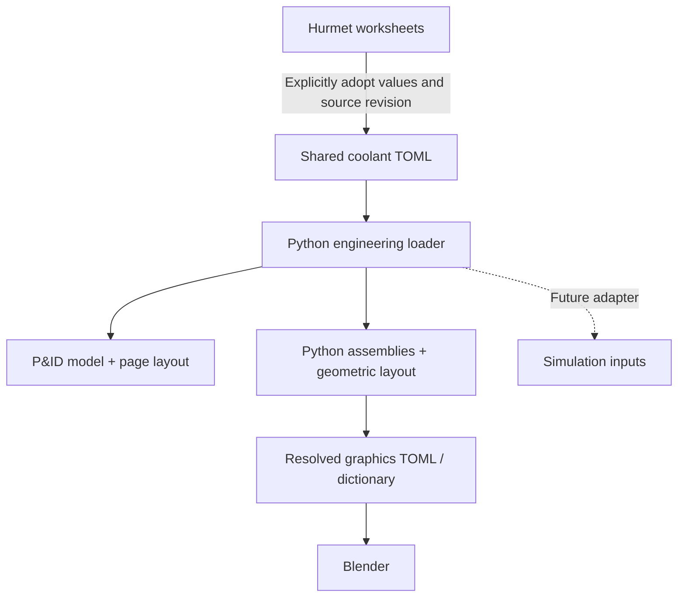

# Shared coolant engineering model

13 October 2026 — D-053. The main coolant system now has one engineering source consumed by the P&ID and graphics. This is the first shared system, not a whole-plant or solver model.

Start with [coolant-system.toml](coolant-system.toml). Its seven components, named ports and six process connections describe R-101, SG-101–103 and P-101–103. Cold connections include pump suction and discharge; the graphics expands each into two physical pipe segments. Stable tags identify the same equipment across views.



## Where to edit

| Information | Authoritative location |
| --- | --- |
| Main coolant equipment IDs, ports and process connections | This TOML's `components` and `connections` tables |
| Adopted bore, wall and insulation allowances | `specifications.hot` and `specifications.cold` |
| Inherited temperatures, flow/pump inputs and target generator duty | `cases.normal` |
| Conditional pressure used for wall screening | `cases.wall_screening`; deliberately separate from operating conditions |
| Calculation equations and published results | Referenced Hurmet worksheets in `calculations/steam-generator/` |
| P&ID instrumentation, candidate valves, storage/transfer and review metadata | [P&ID view](../pids/coolant-system/coolant-system.toml) |
| Drawing positions and schematic routes | [P&ID layout](../pids/coolant-system/layout.toml) |
| Equipment shapes, placements and geometric routes | [Graphics Python](../../../fastSaltModels/models/coolant_assembly.py) and [installation layout](../../../fastSaltModels/models/wistr_installation.py) |

Each shared quantity records `value`, `unit`, `status`, `source` and a worksheet `locator`. A compact example of its meaning is:

```toml
[specifications.hot.wall]
value = 0.025
unit = "m"
status = "conditional_dimension"
source = "wall"
locator = "nominal wall"
```

The implemented schema uses explicit tables. It does not evaluate expressions in TOML. Python composes the assemblies, resolves the geometry and produces detached view documents. The small shared engineering catalog is directly editable; no separate authoring language is needed for its current size. A future Python author can generate this same validated structure when repetition warrants it.

## Calculation adoption and change review

Hurmet remains the calculation authoring and publication tool. The shared model contains selected, explicitly adopted values; it does not parse saved Hurmet math or execute calculations. The adapter only converts units and repeats the existing pump arithmetic. In particular, the pressure-screening assumption is not promoted to a system design pressure, and the 17 m visual SG casing does not revise the worksheet's tube length or pressure drop.

Each source entry pins the worksheet's SHA-256 hash. If a worksheet changes, builds stop with a review message. Recalculate and review the worksheet, update the adopted values and their locators/status as appropriate, then update the source hash deliberately. Even a prose-only change requires acknowledgement; the hash detects a revision, not the significance of that revision. Hash agreement establishes traceability, not numerical or engineering qualification. Do not automatically refresh hashes to suppress an error.

Normal P&ID and Blender builds read the same source. They record both its hash and the adapter hash, plus worksheet hashes, in their generated manifests/documents. A missing sibling repository is an error; the graphics has no silent fallback to old copied dimensions. Keep the repositories side by side, or set `FAST_SALT_HUB` to the hub's absolute directory before running a graphics build.

For a named milestone, preserve the shared TOML, loader/adapter code, view sources, calculation revisions or recoverable Git references, and generated output manifests. A saved `.blend` or resolved graphics TOML remains a snapshot: source edits update it only after rebuilding. Reusing an older `--coolant-model` explicitly reuses that snapshot.

## Build and verify

From `fastSalt` with Python 3.11+:

```sh
python3 design/engineering/fast_salt_engineering/coolant.py
python3 design/pids/coolant-system/build.py --check
python3 design/pids/coolant-system/build.py
```

The first command needs only the standard library. The P&ID also needs its existing ReportLab dependency. To inspect a detached engineering document without Blender:

```sh
python3 design/engineering/fast_salt_engineering/coolant.py \
  --output outputs/engineering/coolant.json
```

From `fastSaltModels`:

```sh
python3 scripts/resolve_coolant.py \
  --pid-model ../fastSalt/design/pids/coolant-system/coolant-system.toml
python3 -m unittest discover -s tests -p test_shared_coolant.py -v
```

The shared module is [fast_salt_engineering/coolant.py](fast_salt_engineering/coolant.py). `read()` validates inputs and provenance, `pid_projection()` supplies the diagram schema, and `graphics_legs()` supplies the graph consumed by the 3D author. P&ID local overrides of migrated engineering fields are rejected. Graphics placement tags bind generators to their existing locations independent of TOML table order. Unsupported topology requires an adapter/layout change and fails explicitly.

## Scope and checks

The initial migration retains the existing numerical values. The rebuilt P&ID PDF, SVGs and registers are byte-identical to the preceding working draft. Resolved graphics components, ports and connections are unchanged. Eight assembly tests, eleven P&ID tests, six cross-view tests and the Blender direct/TOML check pass. A complete installation build also passes with 4,332 meshes. Cross-view tests change one source wall dimension in a temporary project and confirm both the P&ID and all nine graphics pipe segments update, then check ordering independence, forbidden overrides, units/ports, unsupported topology and changed worksheet hashes.

Simulation adapters, automatic Hurmet input/output exchange, material laws, equipment mass, pressure profiles and solver discretizations remain future work. Storage/transfer and other plant systems retain their existing definitions. Solver-specific meshes or control volumes may map many-to-one to these component IDs; a Blender mesh will not automatically become a thermal-hydraulic or neutronics model.
