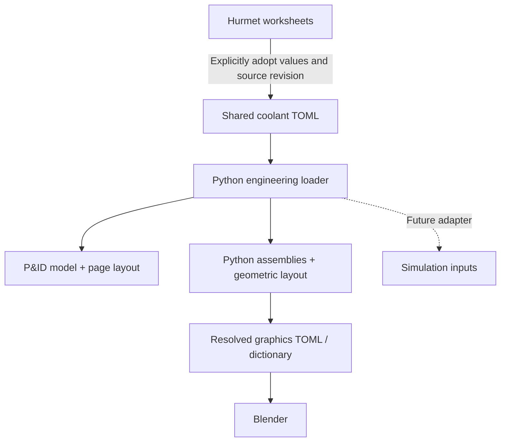

# Shared coolant engineering model

13 October 2026 — D-053. The main coolant system now has one engineering source consumed by the P&ID and graphics. This is the first shared system, not a whole-plant or solver model.

Start with [coolant-system.toml](coolant-system.toml). Its seven components, named ports and six process connections describe R-101, SG-101–103 and P-101–103. Cold connections include pump suction and discharge; the graphics expands each into two physical pipe segments. Stable tags identify the same equipment across views.



## Where to edit

| Information | Authoritative location |
| --- | --- |
| Main coolant equipment IDs, ports and process connections | This TOML's `components` and `connections` tables |
| Adopted bore, wall and insulation allowances | `specifications.hot` and `specifications.cold` |
| Adopted normal hydraulics, temperatures, flow/pump inputs and target generator duty | `cases.normal` |
| Conditional pressure used for wall screening | `cases.wall_screening`; deliberately separate from operating conditions |
| Calculation equations and published results | Referenced Hurmet worksheets in `calculations/steam-generator/` |
| P&ID instrumentation, candidate valves, storage/transfer and review metadata | [P&ID view](../pids/coolant-system/coolant-system.toml) |
| Drawing positions and schematic routes | [P&ID layout](../pids/coolant-system/layout.toml) |
| Equipment shapes, placements and geometric routes | [Graphics Python](../../../fastSaltModels/models/coolant_assembly.py) and [installation layout](../../../fastSaltModels/models/wistr_installation.py) |

Each shared quantity records `value`, `unit`, `status`, `source` and a worksheet `locator`. A compact example of its meaning is:

```toml
[specifications.hot.wall]
value = 0.025
unit = "m"
status = "conditional_dimension"
source = "wall"
locator = "nominal wall"
```

The implemented schema uses explicit tables. It does not evaluate expressions in TOML. Python composes the assemblies, resolves the geometry and produces detached view documents. The small shared engineering catalog is directly editable; no separate authoring language is needed for its current size. A future Python author can generate this same validated structure when repetition warrants it.

## Calculation adoption and change review

Hurmet remains the calculation authoring and publication tool. The shared model contains selected, explicitly adopted values; it does not parse saved Hurmet math or execute calculations. The adapter only converts units and repeats the existing pump arithmetic. In particular, the pressure-screening assumption is not promoted to a system design pressure, and the 17 m visual SG casing does not revise the worksheet's tube length or pressure drop.

Each source entry pins the worksheet's SHA-256 hash. If a worksheet changes, builds stop with a review message. Recalculate and review the worksheet, update the adopted values and their locators/status as appropriate, then update the source hash deliberately. Even a prose-only change requires acknowledgement; the hash detects a revision, not the significance of that revision. Hash agreement establishes traceability, not numerical or engineering qualification. Do not automatically refresh hashes to suppress an error.

Normal P&ID and Blender builds read the same source. They record both its hash and the adapter hash, plus worksheet hashes, in their generated manifests/documents. A missing sibling repository is an error; the graphics has no silent fallback to old copied dimensions. Keep the repositories side by side, or set `FAST_SALT_HUB` to the hub's absolute directory before running a graphics build.

For a named milestone, preserve the shared TOML, loader/adapter code, view sources, calculation revisions or recoverable Git references, and generated output manifests. A saved `.blend` or resolved graphics TOML remains a snapshot: source edits update it only after rebuilding. Reusing an older `--coolant-model` explicitly reuses that snapshot.

## Build and verify

From `fastSalt` with Python 3.11+:

```sh
python3 design/engineering/fast_salt_engineering/coolant.py
python3 design/pids/coolant-system/build.py --check
python3 design/pids/coolant-system/build.py
```

The first command needs only the standard library. The P&ID also needs its existing ReportLab dependency. To inspect a detached engineering document without Blender:

```sh
python3 design/engineering/fast_salt_engineering/coolant.py \
  --output outputs/engineering/coolant.json
```

From `fastSaltModels`:

```sh
python3 scripts/resolve_coolant.py \
  --pid-model ../fastSalt/design/pids/coolant-system/coolant-system.toml
python3 -m unittest discover -s tests -p test_shared_coolant.py -v
```

The shared module is [fast_salt_engineering/coolant.py](fast_salt_engineering/coolant.py). `read()` validates inputs and provenance, `pid_projection()` supplies the diagram schema, and `graphics_legs()` supplies the graph consumed by the 3D author. P&ID local overrides of migrated engineering fields are rejected. Graphics placement tags bind generators to their existing locations independent of TOML table order. Unsupported topology requires an adapter/layout change and fails explicitly.

## Scope and checks

The initial D-053 migration retained the then-existing numerical values; D-061 below replaces the normal hydraulic case. At that initial migration, The rebuilt P&ID PDF, SVGs and registers are byte-identical to the preceding working draft. Resolved graphics components, ports and connections are unchanged. Eight assembly tests, eleven P&ID tests, six cross-view tests and the Blender direct/TOML check pass. A complete installation build also passes with 4,332 meshes. Cross-view tests change one source wall dimension in a temporary project and confirm both the P&ID and all nine graphics pipe segments update, then check ordering independence, forbidden overrides, units/ports, unsupported topology and changed worksheet hashes.

Simulation adapters, automatic Hurmet input/output exchange, material laws, equipment mass and solver discretizations remain future work. Station-pressure screening results are now adopted as metadata; a network pressure solver is not implemented. Storage/transfer and other plant systems retain their existing definitions. Solver-specific meshes or control volumes may map many-to-one to these component IDs; a Blender mesh will not automatically become a thermal-hydraulic or neutronics model.

## D-061 adoption and schema 2

**Historical D-061 values below; D-063 supersedes the SG geometry, pump duty and suction pressure.**

D-061 adopts the UM hydraulic case into the shared engineering model, P&ID equipment register and graphics duty metadata: **18,500 kg/s total**, three equal 6,166.67 kg/s legs, **810–890 K**, and **3.4 m active core height**. At 810 K, pump-inlet density is 1,656.3245 kg/m³ and volume flow is **3.7231 m³/s per pump**. Full itemized loop loss is **230.681 kPa** (14.202 m cold-salt head), with **1.074 MW shaft / 1.118 MW electrical per pump**, **3.355 MW electrical total**. No SG-loss multiplier remains in the active adapter.

Normal station pressures retain the checked mean-density screen: SG tops 1 bar(g), pump suction/discharge 1.660/3.823 bar(g), reactor bottom-plenum midpoint 4.254 bar(g). Pump differential head is distinct from the static-pressure difference between ports at different heights. These values are not design pressures or relief settings.

The **2 MW motor reservations**, casing dimensions, pipe dimensions/insulation and building layout remain unchanged. Existing saved Blender scenes remain snapshots; the resolved coolant document is updated without a full Blender rebuild. SG tube geometry is retained and its 500 MW per-generator duty remains a target; SG thermal rerating, fitting losses, roughness, supplier pump curves/efficiency and NPSH remain provisional. Insulation/wall worksheets retain their earlier screening cases and need review against 890 K; adoption does not requalify them. Tank relocation and SG-failure/relief assessment remain deferred.

Schema 2 replaces `density` with explicit `cold_density`, and `generator_pressure_drop × loop_allowance` with `pump_pressure_rise`. `generator_tube_friction` is retained as an explicitly scoped diagnostic, not total SG loss. `pump_duty()` derives per-pump flow and hydraulic/shaft/electrical power once for both views. Total and per-leg flows must agree. `motor_envelope` pins the earlier worksheet solely to retain the 2 MW reservation. Core and pressure worksheets have their own source records. The P&ID equipment CSV includes duty and station-pressure columns; blanks for other equipment mean unassigned.

For future calculation edits: regenerate/check the itemized worksheet, explicitly review and repin its source, then regenerate/check the pressure worksheet and repin it. Source hashes are not automatically refreshed. View-only adapter changes can alter provenance hashes while leaving all physical routes and numerical results unchanged.

Adoption verification (14 October 2026): 62 pump and 53 pressure Hurmet comparisons plus their sensitivities pass; eight cross-view checks and eleven P&ID tests pass. All nine resolved pipe routes, eighteen ports, eleven component transforms and pump/generator envelopes match the pre-adoption document. The revised circulation sheet was visually checked; generated equipment records separate shaft/electrical demand from motor reservation. No full Blender regeneration or commit.

## Dedicated relief ports — D-062

Each shared SG now includes a `relief_high` semantic port, distinct from `gas_top`. The emergency lines, rupture discs and unresolved receiving boundary are in the P&ID view. The three-leg circulation graph and hydraulic case are unchanged. These ports have no assigned 3D positions yet.

## D-063 — Updated steam-generator and normal hydraulic basis

D-063 adopts the newer `counterSG.xlsx` geometry: **4,902 salt tubes per SG, 20 mm ID / 24 mm OD and 11.920866 m calculated active length**, provisionally used as straight hydraulic length. The 6,536 steam tubes are a separate bank. The 17 m casing, 18,500 kg/s total flow, 810–890 K temperatures and 3.4 m active core remain unchanged. Salt inlet/outlet labels were corrected to 890/810 K; numeric cells and formulas are unchanged.

At the retained flow, mean SG tube velocity is 2.451 m/s. SG tube friction is **70.491 kPa**, or **87.004 kPa including tube ends and collector allowances**. Full-loop pump rise is **172.162 kPa** (10.599 m cold-salt head). Per pump: **801.2 kW shaft / 834.6 kW electrical**; three-pump total **2.504 MW electrical**. Fitting sensitivity is 2.241–3.065 MW, not a certified range. The prior D-061 total was 3.355 MW.

With 1 bar(g) at SG tops, suction is **2.246 bar(g)**, discharge **3.823 bar(g)**, and reactor bottom-plenum midpoint **4.254 bar(g)**. Lower SG resistance raises suction and reduces required pump rise by matching amounts; downstream pressures stay unchanged in this fixed-flow, mean-density screen.

The revised inventory is approximately **452.3 m³**, including **55.1 m³ in all three SG tube banks**. At 890 K, the fixed cold-fill charge requires 478.7 m³, or 526.5 m³ including 10% inventory allowance. The already-selected 8.2 × 16 m storage reservation provides 622.1 m³ working acceptance under existing allowances, leaving 95.6 m³. Tank placement remains pending; the smaller saved Blender tank remains a historical layout envelope.

The shared TOML, P&ID and resolved graphics duty metadata use the checked revision. Existing 2 MW motor reservations and physical equipment/pipe envelopes are retained. Actual SG contact conductance, hydraulic extensions, local coefficients, roughness and pump curves/NPSH remain provisional. No protection setpoints, relief capacity or SG-failure assessment are established. Older Generator sizing and Brayton worksheets remain explicitly historical cases.
