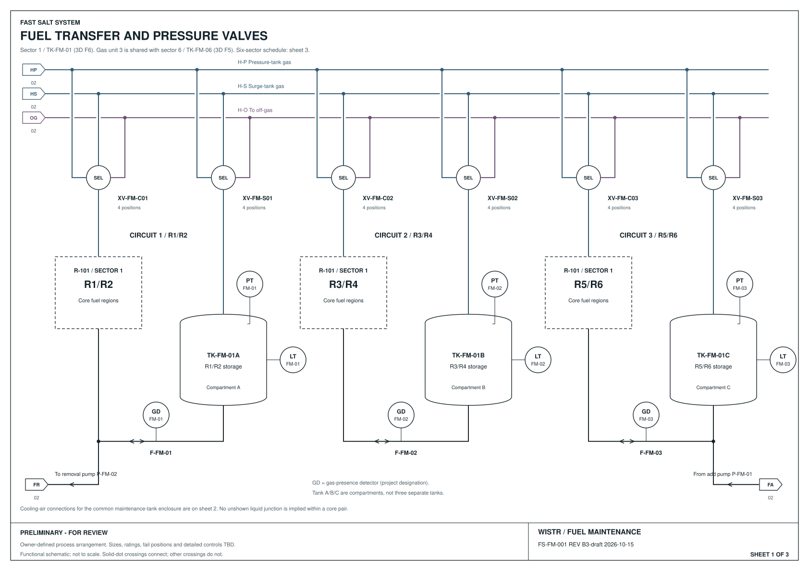
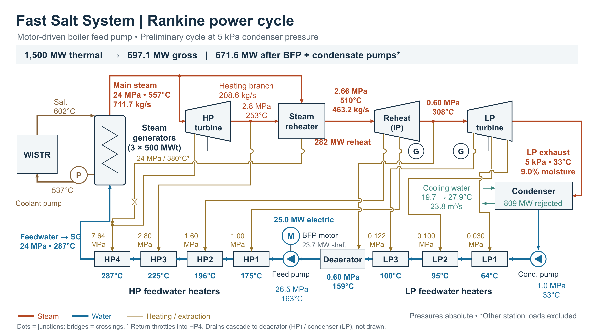

# Viewable results

[Project starting page](../README.md) · [Model gallery](https://github.com/FastSaltSystem/fastSaltModels/blob/aebdd36c7e7e6599c538882262847f7253aa5afb/results/README.md) · [Calculation sources](../calculations/README.md)

Selected drawings and previews are preserved here so they can be read on GitHub without running a builder. Open a PDF to use GitHub's preview, or download it if the preview is unavailable. The SVG sheet links provide individual scalable drawings.

## Auxiliary Brayton cooling study - 19 October 2026

**RS-008, Revision A:** [Five-page PDF](2026-10-19/auxiliary-brayton-rev-a/report.pdf) · [Browser report](2026-10-19/auxiliary-brayton-rev-a/report.html) · [Editable report and archived sources](2026-10-19/auxiliary-brayton-rev-a/README.md) · [Study record](../research/auxiliary-brayton-cooling/README.md).

Compares the saved steam, nitrogen, open-air and supercritical CO₂ auxiliary cooling cases at 30 MW per train, with their power margins, size tradeoffs and limitations. Preserves the historical pump allowance and source hashes. Preliminary study; technical review pending. HTML can be downloaded and opened in a browser; GitHub displays its source unless hosted separately.

## P&ID review snapshot — 15 October 2026

| System | Read the drawing | Revision and scope | Editable source |
| --- | --- | --- | --- |
| Coolant | [Six-sheet PDF](2026-10-15/coolant-system/WISTR-coolant-PID.pdf) · [individual sheets](2026-10-15/README.md#coolant) | B-working, 14 October; coolant circulation, storage, gas and nitrogen interfaces | [TOML and builder](../design/pids/coolant-system/README.md) |
| Absorber | [Four-sheet PDF](2026-10-15/absorber-system/WISTR-absorber-PID.pdf) · [individual sheets](2026-10-15/README.md#absorber) | Existing 15 October draft; separate gas charging and treatment-return connections | [TOML and builder](../design/pids/absorber-system/README.md) |
| Fuel maintenance | [Three-sheet PDF](2026-10-15/fuel-maintenance/WISTR-fuel-maintenance-PID.pdf) · [individual sheets](2026-10-15/README.md#fuel-maintenance) | B3-draft; shared gas units, region-pair transfer and operator-selected storage venting | [TOML and builder](../design/pids/fuel-maintenance/README.md) |

The sheets retain their own preliminary status and unresolved items. Publication preserves an existing drawing; it does not establish equipment qualification or an operating procedure. [File hashes and provenance](2026-10-15/manifest.json).

## Steam power cycle — 11 October 2026

The motor-driven boiler-feed-pump alternative, with temperatures, pressures and heater connections. [Full-size image](../presentations/rankine-cycle-2026-10-11/Fast-Salt-Rankine-cycle-motor-BFP-2026-10-11.png) · [Editable PowerPoint](../presentations/rankine-cycle-2026-10-11/Fast-Salt-Rankine-cycle-motor-BFP-2026-10-11.pptx) · [Source and calculation notes](../presentations/rankine-cycle-2026-10-11/README.md).

## Read the calculations

Hurmet Markdown remains the editable calculation format. GitHub shows its source text; interactive evaluation requires Hurmet. These links are source worksheets, not a claim that GitHub recalculates them:

- [Core coolant pressure loss](../calculations/reactor/Core%20coolant%20pressure%20loss%20-%20Hurmet.md)
- [Itemized coolant pump estimate](../calculations/steam-generator/Itemized%20coolant%20pump%20estimate%20-%20Hurmet.md)
- [Normal coolant pressure profile](../calculations/reactor/Normal%20coolant%20pressure%20profile%20-%20Hurmet.md)
- [Boiler-feed-pump drive comparison](../calculations/power-cycle/BFP%20drive%20comparison%20-%20Hurmet.md)

Rendered calculation views remain local at present. The university publication index also contains local reference paths; those documents have not been republished in this results collection.

## Refreshing published results

Keep routine builds in ignored `outputs/`. For a review milestone, copy selected documents into a new dated directory, record the source commit and hashes, inspect the drawings, and update this index in a pull request. Preserve previous snapshots. Reports in each snapshot record the checks actually performed, with their original scope and limitations.
